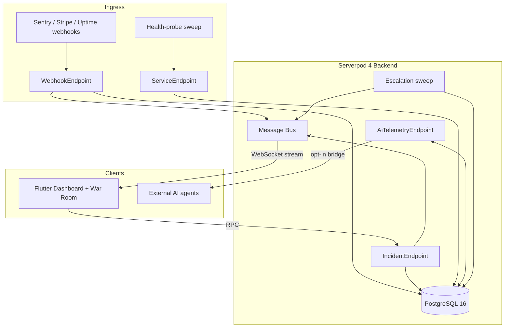

# 🚨 IncidentPulse: Open-Source Realtime Incident Commander & War Room

> Built with **Serverpod 4 (Dart Backend) + Flutter (Cross-Platform Web/Desktop/Mobile)**.  
> Lightweight, zero-bloat incident response, webhook ingress, and live triage war room for solo SaaS founders, developers, agencies, and autonomous AI agents.

---

## 🏆 For Hackathon Judges (60-second test path)

**Live demo, no setup:** https://incident-pulse.serverpod.space/ — Flutter dashboard wired to the production Serverpod backend at `https://incident-pulse.api.serverpod.space`. Stays up through judging (Oct 20).

**Fastest way to see it work:**
1. Open the dashboard — the service matrix shows live status.
2. Fire a synthetic alert via `simulateMockAlert` (Incident endpoint), or run `./scripts/mock_emitter.py all` locally.
3. Watch the incident land in real time, open its War Room, post a note, acknowledge it, resolve it.
4. Escalation, health probes, and retention cleanup run as idempotent sweeps (`runDueEscalations`, `runHealthProbes`, `runRetentionCleanup`) — triggerable on demand, no cron needed to verify.

**System diagram:**



**Endpoint inventory** (all methods verified against `main`; Serverpod RPC — call via the generated client in `incident_pulse_client/` or Serverpod Insights):

| Endpoint | Method | Purpose |
|---|---|---|
| Incident | `getActiveIncidents` / `getAllIncidents` / `getServiceIncidents` | List incidents (active / all / by service) |
| Incident | `createIncident` | Manually raise an incident |
| Incident | `simulateMockAlert` | Fire a synthetic alert — the one-click demo path |
| Incident | `acknowledgeIncident` / `resolveIncident` | State-machine transitions |
| Incident | `runDueEscalations` | Sweep: escalate overdue unacknowledged incidents |
| Service | `listServices` / `createService` | Manage monitored services |
| Service | `updateServicePing` / `updateServiceStatus` | Probe target + status |
| Service | `updatePrivacyAndRetention` | Retention window (30/90/180/365d) + PII toggles |
| Service | `purgeServiceHistory` | GDPR right-to-erasure |
| Service | `runHealthProbes` / `runRetentionCleanup` | Sweeps: synthetic uptime checks, payload scrubbing |
| Webhook | `ingestWebhook` | Alert ingress (Sentry/Stripe/uptime) with PII redaction at the door |
| WebhookSubscription | `listSubscriptions` / `createSubscription` / `deleteSubscription` / `testSubscription` | Manage + dry-run outbound webhook subscriptions |
| WarRoom | `postWarRoomNote` / `getWarRoomEvents` | Realtime triage timeline over the Serverpod Message Bus |
| AiTelemetry | `getTelemetrySummary` | MTTR / active counts for opted-in services (key-authenticated) |
| AiTelemetry | `submitAiDiagnosis` | AI agent posts diagnosis + diff into the War Room |
| AiTelemetry | `recordReliabilityReport` | Store aggregated reliability benchmarks |

Full protocol details, data models, and the privacy architecture: [ARCHITECTURE.md](ARCHITECTURE.md).

---

## 🌟 Why IncidentPulse?

Modern incident management software (PagerDuty, Datadog) is enterprise-priced ($30+/seat/mo), heavily bloated, and complicated for solo developers and agile teams.

**IncidentPulse** delivers a lightning-fast, self-hostable incident command center:
- **⚡ Instant Webhook Ingress**: Receives and standardizes alerts from Sentry, Stripe, GitHub Actions, AWS, and uptime pingers.
- **📡 Realtime WebSockets War Room**: Live incident triage room with real-time markdown notes, chat, and status streaming powered by Serverpod WebSockets.
- **⏰ Smart Escalation Ladders**: Background `FutureCall` workers that page responders if critical issues go unacknowledged.
- **🤖 Pluggable AI Telemetry Bridge**: Generic, authenticated bridge allowing any autonomous coding agent or LLM (e.g. Claude, OpenAI, custom agents) to inspect error telemetry and submit automated root-cause diagnoses into the War Room.
- **🔒 Privacy & Compliance by Design (GDPR / CCPA / SOC2)**:
  - **Strict Tenant Data Isolation**: AI diagnostic bridges are **strictly opt-in** and disabled by default for external customer data.
  - **Balanced Retention Policy**: Configurable retention windows (30, 90, 180, 365 days). Raw payloads and PII are automatically scrubbed upon expiration while retaining high-level post-mortems and MTTR metrics.
  - **Automatic PII Redaction**: Scrubs authorization tokens, cookies, email addresses, and credit card numbers at ingress.
  - **Right to Erasure**: Built-in one-click purge API.
- **🛡️ Free & Self-Hostable**: 100% open-source under the MIT license, with single-command Docker deployment.

---

## 🏗️ Architecture

IncidentPulse utilizes Serverpod 4's full-stack Dart architecture:

```
incident-pulse/
├── docker-compose.yaml                # PostgreSQL 16 + Redis production/dev stack
├── docker-compose.staging.yaml        # Staging stack with mock microservice
├── scripts/
│   └── mock_emitter.py                # Synthetic alert generator (Stripe, Sentry, Uptime)
├── incident_pulse_server/             # Serverpod 4 Backend Server
│   ├── config/                        # Environment configs (passwords.yaml is gitignored)
│   ├── lib/server.dart                # Server bootstrapper & future calls registration
│   └── lib/src/
│       ├── endpoints/
│       │   ├── incident_endpoint.dart           # Incident CRUD & state machine
│       │   ├── webhook_endpoint.dart            # Sentry, Stripe, uptime webhook ingress
│       │   ├── war_room_endpoint.dart           # Realtime WebSockets streaming
│       │   ├── service_endpoint.dart            # Service registration & retention settings
│       │   └── ai_telemetry_endpoint.dart       # Pluggable AI agent telemetry bridge
│       ├── models/ (.spy.yaml)
│       │   ├── service.spy.yaml                 # Monitored apps
│       │   ├── incident.spy.yaml                # Incidents
│       │   ├── incident_event.spy.yaml          # Live war room timeline events & chat
│       │   ├── escalation_policy.spy.yaml       # Escalation rules
│       │   └── reliability_report.spy.yaml      # Aggregated reliability metrics
│       └── future_calls/
│           ├── escalation_future_call.dart      # Escalation ladder worker
│           ├── health_probe_future_call.dart    # Synthetic uptime pinger
│           └── retention_cleanup_future_call.dart # Automated GDPR/compliance payload scrubber
├── incident_pulse_client/             # Shared Dart Client Protocol
└── incident_pulse_flutter/            # Cross-Platform Flutter Dashboard & War Room
    └── lib/
        ├── core/theme.dart                      # High-contrast incident war room theme
        ├── core/client.dart                     # Serverpod client singleton
        ├── features/dashboard/                  # Monitored service matrix & active alerts
        ├── features/war_room/                   # Live WebSockets triage war room & timeline
        └── features/services/                   # Service registration, privacy toggles & retention
```

---

## 🚀 Quick Start

### 1. Prerequisites
- [Docker](https://www.docker.com/) & Docker Compose
- [Dart SDK](https://dart.dev/get-dart) (>=3.3.0) & [Flutter](https://flutter.dev/) (>=3.22.0)
- [Serverpod CLI](https://serverpod.dev/docs/getting-started): `dart pub global activate serverpod_cli`

### 2. Configure Environment & Passwords
Copy the sample passwords file:
```bash
cp incident_pulse_server/config/passwords.example.yaml incident_pulse_server/config/passwords.yaml
```

### 3. Start Database & Redis
```bash
docker compose up -d
```

### 4. Run Serverpod Backend
```bash
cd incident_pulse_server
dart pub get
dart run bin/main.dart --mode development
```
- API endpoints: `http://localhost:8080`
- Realtime WebSockets: `ws://localhost:8080/websocket`
- Serverpod Insights Diagnostic GUI: `http://localhost:8082`

### 5. Run Flutter Cross-Platform Dashboard
```bash
cd ../incident_pulse_flutter
flutter pub get
flutter run -d chrome  # or -d macos / linux / windows / ios / android
```

### 6. Test with Staging Mock Generator
In another terminal, simulate live failures:
```bash
./scripts/mock_emitter.py all
```

---

## 🤖 Hooking Up an AI Agent (e.g. Custom LLM / Autonomous Assistant)

IncidentPulse exposes a pluggable endpoint at `AiTelemetryEndpoint`:
1. Set the pre-shared secret in your server environment:
   ```bash
   export AI_TELEMETRY_BRIDGE_KEY="your_secure_bridge_key"
   ```
2. Your external agent or script calls `getTelemetrySummary` and `submitAiDiagnosis` using `authToken: your_secure_bridge_key`.
3. The server validates that the requested service has `enableAiBridge == true` or `isInternalOwner == true`. Customer data is strictly isolated and inaccessible unless explicitly enabled.

---

## 📄 License
MIT License. Free for solo builders, open-source contributors, and self-hosting.
